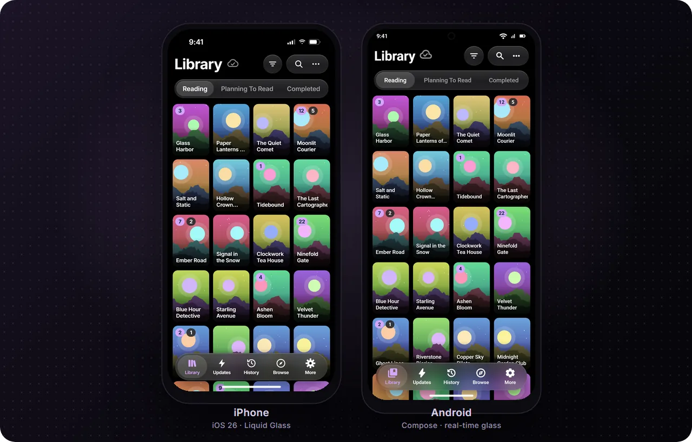
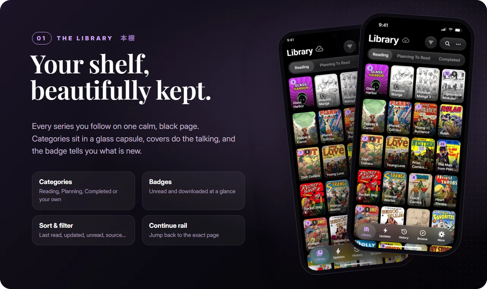
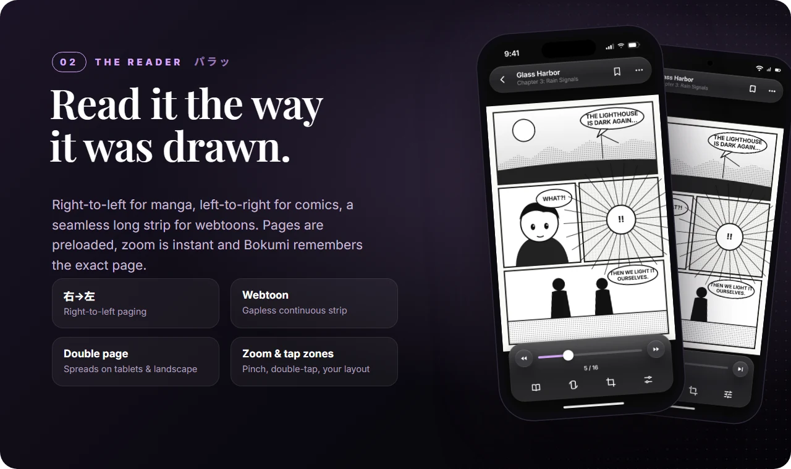
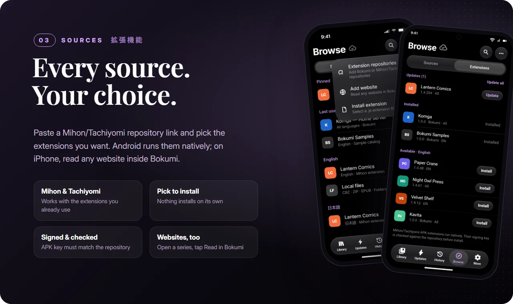
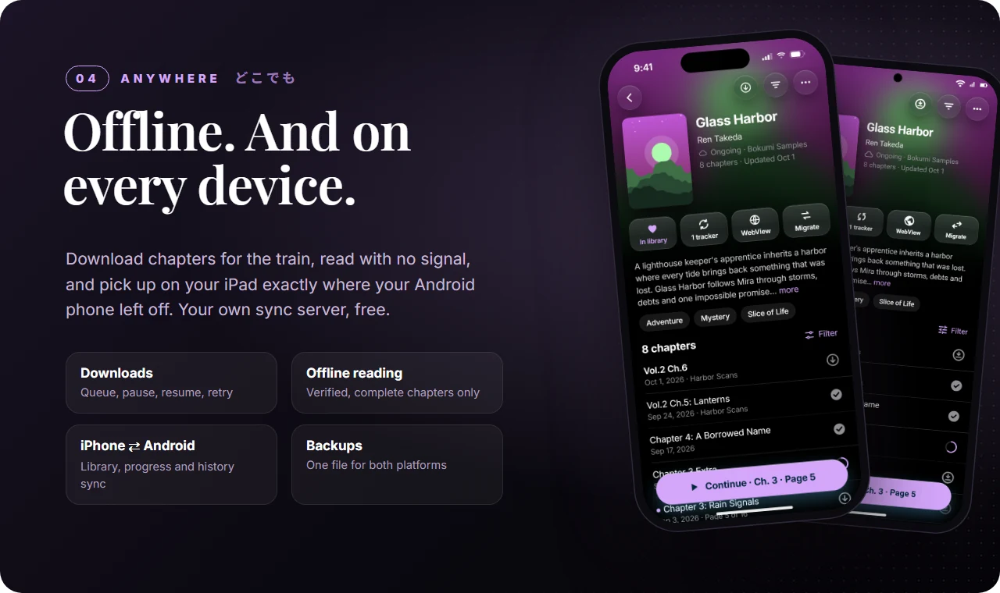
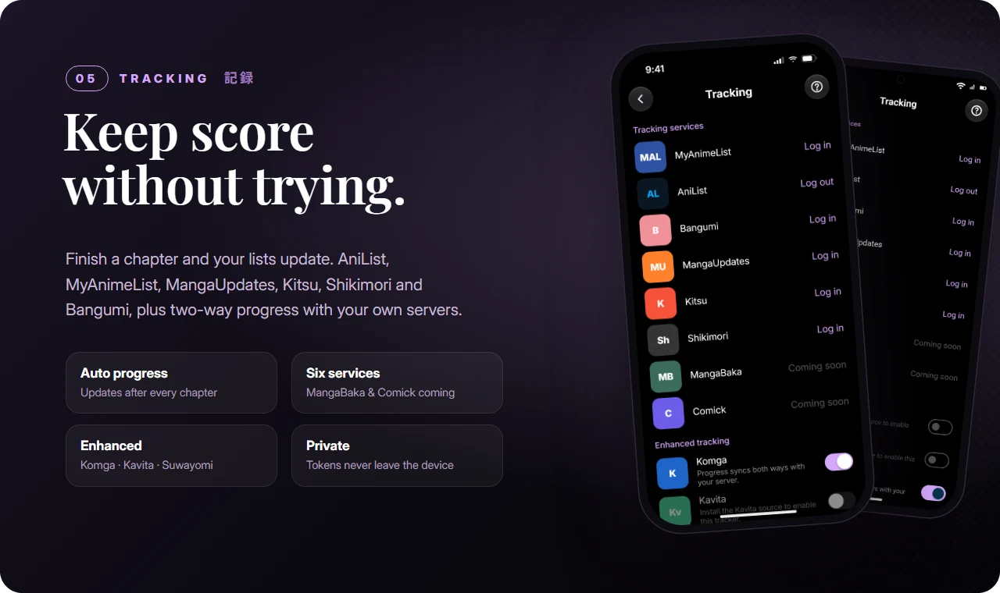
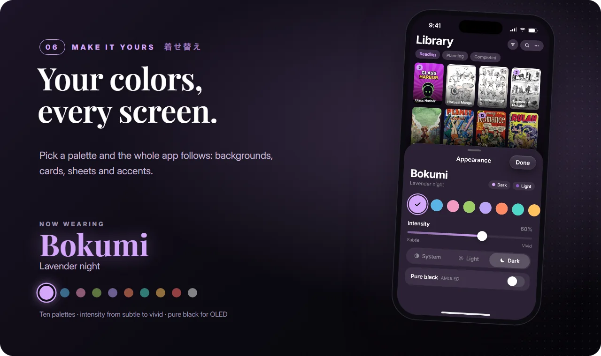

  

  
  &nbsp;&nbsp;
  

Free · no ads · no tracking · developer preview

 

  

<i>One library on every device, with each chapter right where you left it.</i>

  

 

  

  

  

  

  

 

## ✦ Made for manga readers

| | |
|:--|:--|
| 📖 **右 → 左 by default** | Manga read right-to-left, comics left-to-right, manhwa as one seamless webtoon strip. Bokumi remembers the mode for every series. |
| 🧩 **Your extensions** | Add the Mihon/Tachiyomi repositories you already trust and pick what to install. Nothing installs on its own. |
| 🌐 **Websites inside Bokumi** | Add any site you read and open it in Bokumi. On a series or chapter, tap **Read in Bokumi** to get the library, progress and reader. |
| 🚃 **Offline for the commute** | Download chapters ahead and read with no signal. Only complete, verified chapters show as downloaded. |
| 🔁 **Pick up anywhere** | Phone, tablet, iPhone or Android: your library, progress and history follow you with optional sync, and you can see exactly what is synced for each website. |
| 📦 **Bring your library** | Import a Mihon/Tachiyomi backup and keep your progress, categories and tracking. |
| 🌙 **Easy on the eyes** | Ten palettes that color the whole app, from a subtle tint to vivid. Pure black for OLED, and Liquid Glass on iOS 26. |

## ✦ Get Bokumi

### Android

1. Download **`Bokumi-…-android.apk`** from the [Releases page](https://github.com/devCaspian-hash/Bokumi-App/releases).
2. Open it and allow installs from your browser or file manager (Android 11 or newer).
3. In Bokumi go to **Browse → ⋯ → Extension repositories**, paste a repository link you trust, then pick extensions under **Extensions**.

### iPhone & iPad

Coming to TestFlight. Mihon/Tachiyomi APK extensions are Android code, so iPhone and iPad can't run them. Instead, add any website under **Browse → ⋯ → Add website** and read it inside Bokumi, or install Bokumi extensions from a repository you add.

## ✦ FAQ

<b>Is Bokumi free?</b>
 Yes. There are no ads, no subscriptions and no paywalled features.

<b>Does Bokumi come with manga?</b>
 No. Bokumi is a reader. You add sources you are allowed to use: extensions from repositories you choose, websites you add, your own Komga or Kavita server, or your own CBZ/ZIP/EPUB files.

<b>Can I move over from Mihon or Tachiyomi?</b>
 Yes. Import your <code>.tachibk</code> backup under More → Backup &amp; Restore. On Android your Mihon extensions run inside Bokumi.

<b>What does Bokumi know about me?</b>
 Nothing leaves your device unless you turn something on: sync with a server you choose, or a tracker login. There is no analytics. See <a href="PRIVACY.md">PRIVACY.md</a>.

<b>Are extensions safe?</b>
 Bokumi checks that every APK extension is signed by the repository's key and asks you to trust that repository. Like in Mihon, APK extensions run with the app's permissions, so only install extensions you trust.

<b>Why "developer preview"?</b>
 Bokumi is new. It is built and tested automatically, but it has not been tested on many physical devices yet. Expect rough edges, and back up your library (More → Backup &amp; Restore) before updating.

 

Bokumi ships no manga and no sources. Add only content you are allowed to read. Open-source components: <a href="THIRD-PARTY-NOTICES.md">THIRD-PARTY-NOTICES.md</a>. Bokumi is not affiliated with Mihon, Tachiyomi, Suwayomi or any tracking service.

