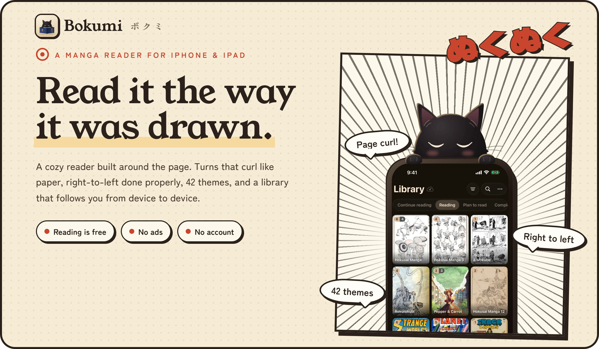
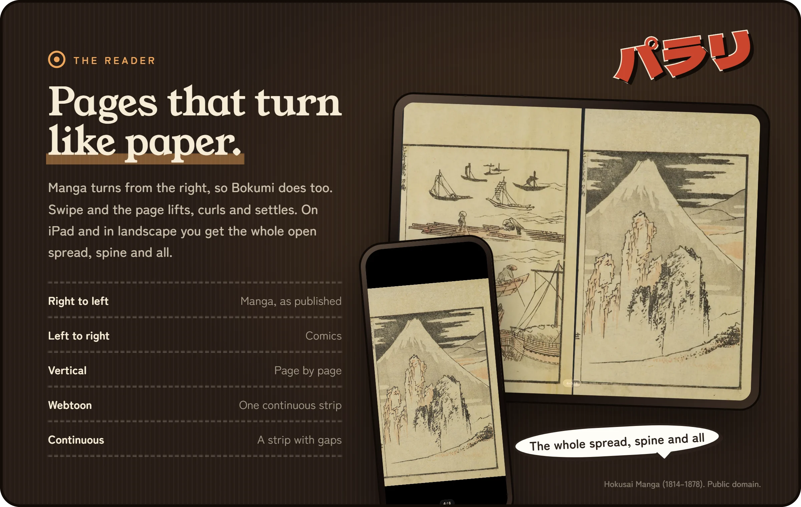
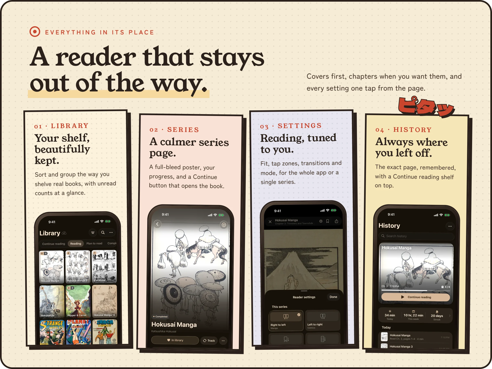
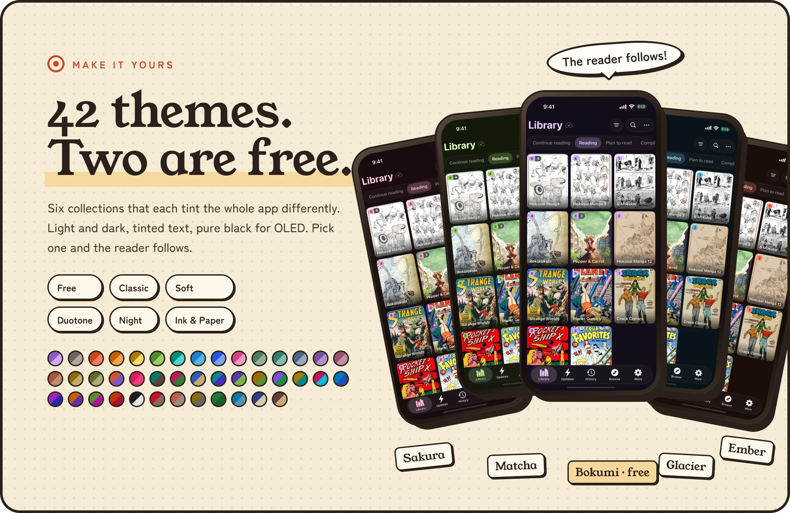
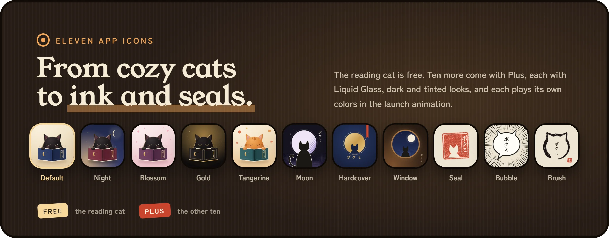
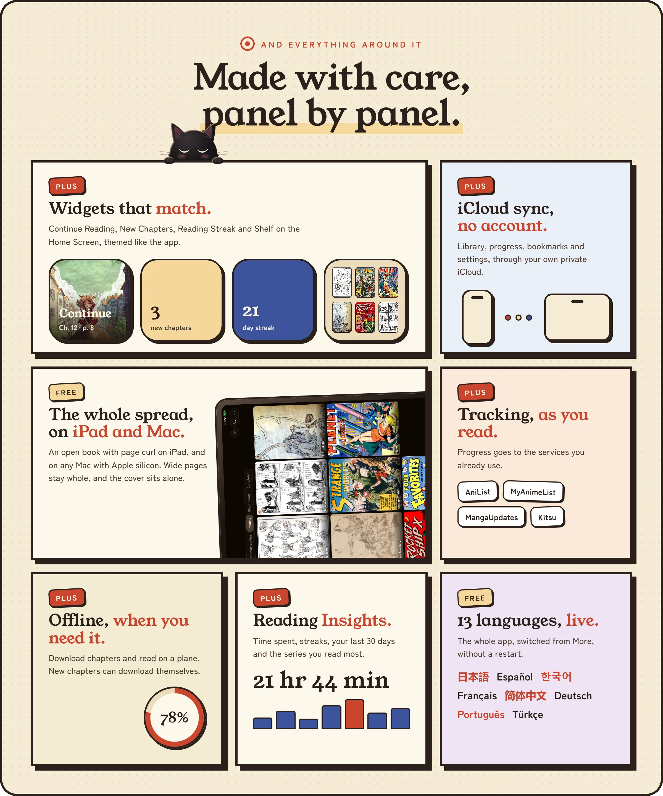
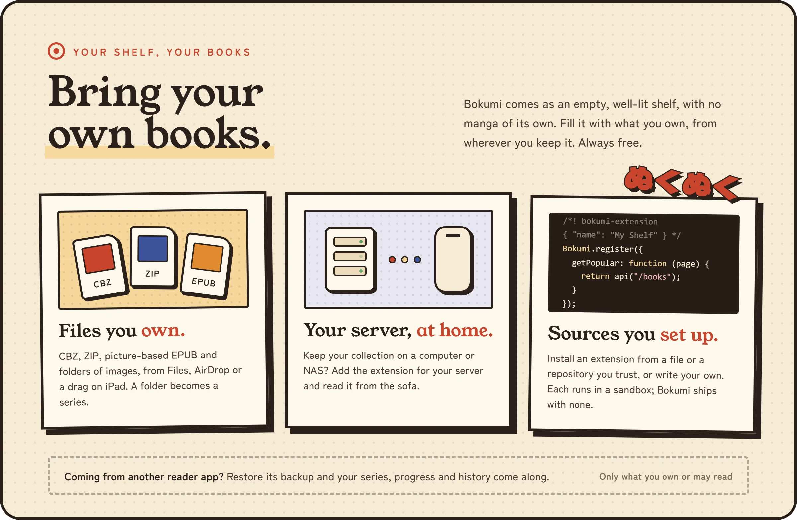
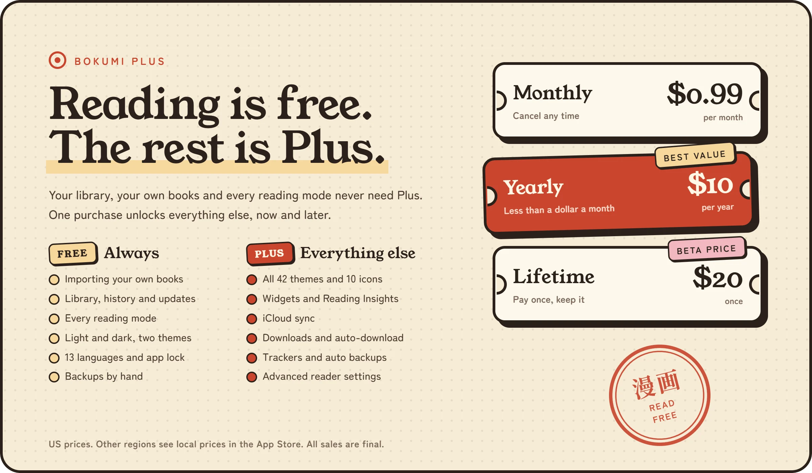
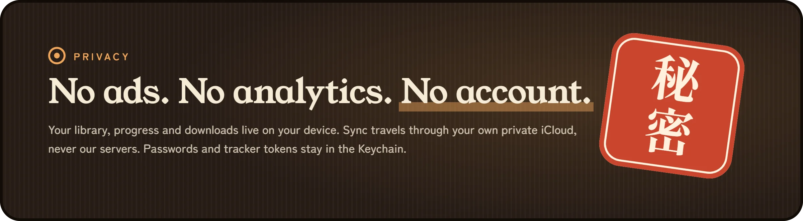
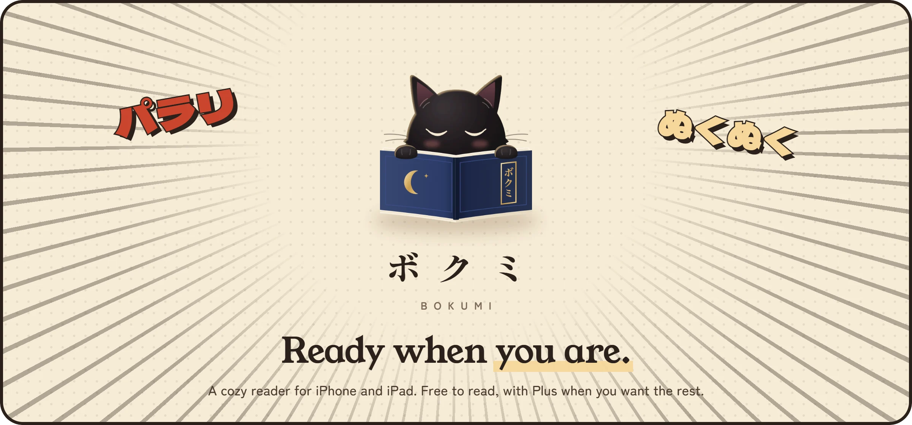

  

  
  &nbsp;
  

<b>Coming soon to iPhone, iPad and Android</b> · reading is free · no ads · no analytics · no account

<h3 align="center">A manga reader that treats the page like paper.</h3>

Bokumi (ボクミ) is a cozy, premium reader for iPhone, iPad and Mac, with Android on the way. Pages curl when you turn them, manga reads from the right, webtoons scroll without a seam, and your shelf, progress and settings follow you everywhere through your own iCloud.

 

  

  

  

  

  

  

  

 

## ✦ Why readers pick Bokumi

| | |
|:--|:--|
| 📖 **右 → 左, properly** | Manga opens from the right, comics from the left, long strips as one seamless webtoon. Bokumi remembers the mode for every series. |
| 🍃 **Page curl** | Swipe and the page lifts, curls and settles. On iPad and Mac you get the open spread, spine and all. |
| 🐈‍⬛ **Cozy, not cluttered** | Covers first, a calm poster-style series page, and a Continue button that opens the book straight away. |
| 🎨 **42 themes, 11 icons** | Six collections that tint the whole app, tinted text, pure black for OLED, Liquid Glass on iOS 26. |
| 📂 **Bring your own** | CBZ, ZIP, EPUB and folders of images from the Files app, a media server you run at home, or extensions you trust or write yourself. Bokumi ships with no content and no sources. |
| ☁️ **Everywhere** | iCloud sync with no sign-in, Home Screen widgets, offline downloads, AniList / MyAnimeList / MangaUpdates / Kitsu. |
| 🔒 **Yours** | No ads, no analytics, no account. App lock, an incognito switch, and tracker tokens kept in the Keychain. |

 

  
   <i>The launch animation: the cat turns the page the manga way.</i>

 

## ✦ Get Bokumi

| | |
|:--|:--|
| **iPhone · iPad · Mac** | **Coming soon** to the App Store. iOS 18 or later, and Macs with Apple silicon through "Designed for iPad". |
| **Android** | **Coming soon.** Not available yet, and there is no official Android download right now. |
| **Your books** | Import CBZ, ZIP, picture-based EPUB or a folder of images from the Files app. A folder becomes a series, and every volume inside it a chapter. |
| **Your own sources** | Install an extension from a file or from a repository you trust, or write your own. Only add sources you are allowed to read from. |
| **Bokumi Plus** | $0.99 / month, $10 / year or $20 lifetime (beta price). Reading and importing your own books stay free. Purchases go through Apple, and all sales are final. |

## ✦ FAQ

<b>When can I get Bokumi?</b>
 Soon. Bokumi is coming to the App Store for iPhone, iPad and Mac, and to Android. Neither is available yet.

<b>Is Bokumi free?</b>
 Reading is free, with no ads: your library, history and updates, every reading mode, importing your own books, light and dark mode and app lock. Bokumi Plus unlocks the rest: the other themes and app icons, widgets, offline downloads, iCloud sync, trackers, automatic backups and extra reader options. Plus unlocks app features, never content. If Plus lapses, nothing is deleted. All sales are final; refunds are handled by Apple.

<b>Does Bokumi come with manga?</b>
 No. Bokumi is a reader. Bring what you own or have the right to read: your own CBZ, ZIP and EPUB files, a media server you run at home, or a source you set up yourself. Bokumi does not condone piracy.

<b>Can I bring my library from another reader app?</b>
 Yes. Make a backup in the other app, then restore it in Bokumi under More → Backup &amp; restore. Your series, progress, categories, history and trackers come along, and restoring never deletes anything.

<b>What does Bokumi know about me?</b>
 Nothing leaves your device unless you turn something on: iCloud sync goes to your own private iCloud, and a tracker only hears from Bokumi after you log in to it. There is no analytics and no account. See <a href="PRIVACY.md">PRIVACY.md</a>.

<b>Are extensions safe?</b>
 Each extension runs in its own sandbox. Before you install one, Bokumi shows which web addresses it may contact, and it can't reach anything else. Extensions never see your iCloud, your sync data or your tracker logins. Still, only add extensions you trust.

<b>✦ Brand</b>

 

Cream paper, warm brown-black ink, a vermilion hanko and the indigo of the cat's book. Display type is Young Serif, UI type Zen Maru Gothic, Japanese in Shippori Mincho.

| Paper | Ink | Vermilion | Indigo | Lamp |
|:---:|:---:|:---:|:---:|:---:|
| `#F6EBD5` | `#2B211B` | `#C9452E` | `#25376F` | `#F6D79B` |

The app's default theme accent is lavender `#D4A6FA`.

 

Bokumi is a reader. It ships no manga, no comics and no sources, and it does not condone piracy: read only what you own or have the right to read. The README art uses real iPhone and iPad screenshots with public-domain and CC BY covers (<a href="COVER-CREDITS.md">credits</a>). Open-source components: <a href="THIRD-PARTY-NOTICES.md">THIRD-PARTY-NOTICES.md</a>. Bokumi is not affiliated with any publisher, content provider or tracking service.

